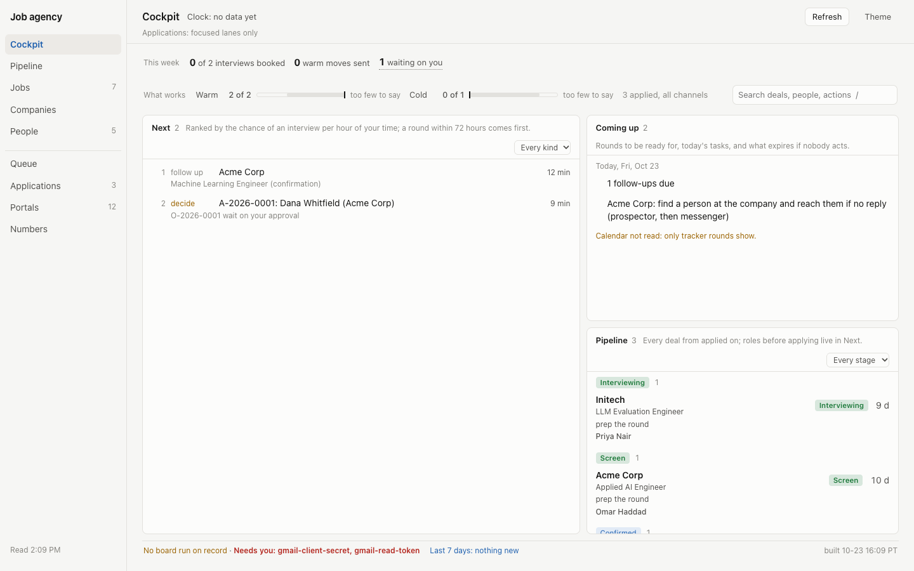
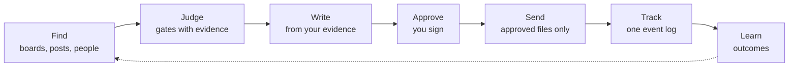
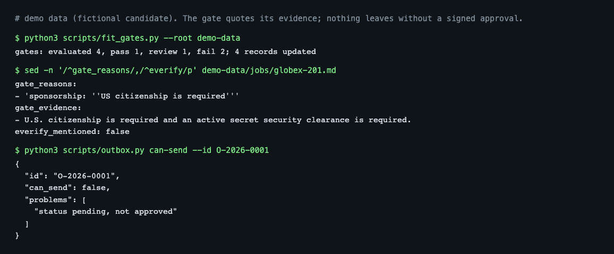
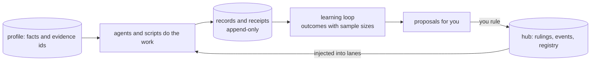

<p align="center">
  <picture>
    <source media="(prefers-color-scheme: dark)" srcset="docs/assets/logo-dark.svg">
    
  </picture>
</p>

<h1 align="center">jaja: your job agency in Claude Code</h1>

<p align="center"><b>A job-search agency for Claude Code: a team of agents that finds roles and people, gates and ranks them,
tailors pages from your own evidence and drafts every message, and never sends anything without your yes.</b></p>

<p align="center"><i>jaja is how Spanish writes laughter: because a job search deserves a smile now and then.</i></p>

<p align="center">
  <a href="https://claude.com/claude-code"></a>
  <a href="https://modelcontextprotocol.io"></a>
  <a href="https://www.python.org"></a>
  <a href="https://yaml.org"></a>
  <a href="https://github.com/openai/codex"></a>
  
  <a href="LICENSE"></a>
  
</p>

Scripts count, gate and check; models judge and draft; you decide and sign. Your profile, contacts, jobs and writing
style live in your own data folder and never touch this repository.

<p align="center"></p>
<p align="center"><sub>The dashboard on the bundled demo data (a fictional candidate). Nothing real appears in this repository.</sub></p>

## Quick start

```bash
git clone <repo-url> ~/jaja && cd ~/jaja
./install.sh --demo --yes          # synthetic demo data + a health check; nothing real, nothing sent
claude plugin marketplace add ./ && claude plugin install jaja@jaja --scope user
```

Then `cd ~/jaja-demo && claude` and try `/jaja:daily-job-plan`, `/jaja:score-fit` or `/jaja:research-company`.
The installer ends with `scripts/doctor.py`; on a clean machine it reports 0 failures. For your own search run
`./install.sh --data ~/jaja-data` (a blank skeleton) and follow [getting started](docs/guides/getting-started.md).
Requirements: macOS or Linux, Python 3.11+, Claude Code; [`uv`](https://docs.astral.sh/uv/) is recommended for the MCP server.
Optional extras (Gmail and Calendar, resume rendering, PDF checks): `pip install -r requirements-optional.txt`.

## How it works

The daily flow. Every box that touches the outside world stops at an approval you sign.



The architecture. The plugin is this repository; everything personal stays in your data folder.




## The team

30 role agents in seven teams, each defined by a card (charter, tools, autonomy tier, model, budget, KPIs). Open a team:

<details><summary><b>Find</b> (4)</summary>

| Agent | Does |
|---|---|
| `job-scout` | discovers postings from boards, feeds and alerts |
| `platform-scout` | reads platform terms and picks the allowed channel |
| `inbox-harvester` | turns recruiter and referral mail into contacts |
| `company-researcher` | builds cited company dossiers |

</details>

<details><summary><b>Judge</b> (4)</summary>

| Agent | Does |
|---|---|
| `fit-scorer` | gates and scores jobs against your evidence |
| `role-analyst` | decodes a posting into ranked needs |
| `legal-visa` | tracks work-authorization clocks and risk |
| `prospect-triage` | ranks contacts by warmth and fit |

</details>

<details><summary><b>Write</b> (10)</summary>

| Agent | Does |
|---|---|
| `resume-tailor` | builds a tailored resume from the base |
| `resume-editor` | editorial gate for truth, fit and format |
| `base-comparer` | blind A/B of a variant against the base |
| `hiring-manager-persona` | reads the page as the hiring manager |
| `technical-ai-reviewer` | checks technical claims for precision |
| `technical-recruiter-reviewer` | screens the page as the company's recruiter |
| `writer` | drafts documents and posts, never sends |
| `profile-editor` | keeps the master profile aligned and sourced |
| `linkedin-editor` | keeps LinkedIn true to the profile |
| `apply-assist` | builds and lints application packs |

</details>

<details><summary><b>Reach out</b> (4)</summary>

| Agent | Does |
|---|---|
| `prospector` | finds the warmest human path into a role |
| `messenger` | drafts every reply and follow-up |
| `negotiator` | offers: bands, comparison, scripts |
| `sender` | executes approved sends, one file at a time |

</details>

<details><summary><b>Track</b> (3)</summary>

| Agent | Does |
|---|---|
| `tracker-ops` | keeps one true event log per application |
| `mail-triage` | classifies mail and syncs the records |
| `corpus-keeper` | owns your profile records and evidence ids |

</details>

<details><summary><b>Prepare</b> (1)</summary>

| Agent | Does |
|---|---|
| `prep-coach` | interview packs, mocks and debriefs |

</details>

<details><summary><b>Run the day</b> (4)</summary>

| Agent | Does |
|---|---|
| `ops-watchdog` | routine health and silence alerts |
| `reviewer` | clean-context gate before anything is done |
| `researcher` | cited, read-only research |
| `engineer` | code work through branches and pull requests |

</details>

Around them: **52 skills** (`/jaja:<name>`), **8 lanes** (`apply`, `focused`, `hunt`, `posts`, `prep`, `recruiter`,
`research`, `resume`), **16 routines** (all disabled), **9 guard hooks** and a **24-tool MCP server**. Full lists:
[reference](docs/REFERENCE.md).

## Profile, agents and memory

| | How it works |
|---|---|
| **Your profile** | `profile/facts.yaml` and `profile/evidence.yaml` hold what you can prove, one evidence id per claim. Every resume line, answer and letter must cite an id; checks refuse a claim with no source and strings you listed as "holds". One frozen, hash-pinned base resume; a tailored variant ships only if it beats the base in a blind comparison. |
| **Agent profiles** | A role card (`agents/<name>.md`) states purpose, allowed tools, autonomy tier (T0 to T4), model, effort, budget, KPIs, stop conditions and denied commands. `scripts/kernel/sync.py` turns the cards into Claude Code agents (and optional Codex adapters) and `--check` catches drift. |
| **Memory** | Your data folder is the single source of truth: records, the hub's rulings, events and registry, append-only logs and run receipts, and the learning loop that turns outcomes into proposals. None of it lives in this repo. |



## Design nuances

What makes it different, one line each. Each is enforced by a script or hook; [docs/NUANCES.md](docs/NUANCES.md) names it.

**Safety**
- Nothing goes out without your yes: tiers T0 to T4, an approval file per outward action, denied-command hooks.
- Connectors are optional and read-only first; sending uses a separate token and a separate login.
- Pacing caps, gaps and a block-page stop protect your accounts; a block stops every lane.
- Routines ship disabled; each writes a receipt and a watchdog flags silence.

**Truth**
- Every claim on a page cites an evidence id from your own records; no source, no claim.
- Gates fail with the exact line they quoted, so you can overrule them.
- One frozen base resume; a variant ships only if it beats the base in a blind comparison.
- Missing is not empty: a check that could not run says so instead of passing.

**Structure**
- Scripts count and check, models judge and draft.
- One writer per file; lanes, an orchestrator and a hub of events and rulings coordinate sessions.
- Adapters are generated from the cards and a hook blocks editing them; one source of truth per thing.
- History is append-only: receipts, events and journals are never rewritten.
- Each role declares its tools, tier, model and budget on its card.
- A leak guard fails any commit that would carry your records into the repository.

## Engineering at a glance

| | |
|---|---|
| Tests | 5,192 tests pass on the demo data with no real data and no network; 321 test files plus 70 MCP tests |
| Scope | 142 scripts, about 76,000 lines of Python (standard library, PyYAML, requests) |
| Architecture | code, your data and a runtime folder kept apart: [architecture](docs/ARCHITECTURE.md), [design decisions](docs/DESIGN-DECISIONS.md) |
| Config seam | identity, style and policy come from config with neutral defaults; tests run as a synthetic persona |
| Health | `python3 scripts/doctor.py` checks install, config, hooks, adapters, MCP server and leak guard |

## Who it is for

For engineers and other technical job seekers who already use Claude Code and want a structured, auditable pipeline for a
long search: many roles, many people, many drafts, one true record. Not for you if you want a bot that applies for you
without review (the design refuses that), or if you do not want to keep your own evidence and records in files.

| | jaja | Prompting Claude by hand | Auto-apply bots | A tracker app |
|---|---|---|---|---|
| Approval before anything goes out | every outward action | you remember to | usually none | n/a |
| Claims checked against your evidence | yes | no | no | no |
| Auditable records you own | plain files | chat history | vendor account | vendor account |
| Setup effort | an afternoon | none | minutes | minutes |

Details and honest trade-offs: [comparison](docs/COMPARISON.md), [FAQ](docs/FAQ.md).

## Documentation

[Getting started](docs/guides/getting-started.md) · [Your first search](docs/guides/your-first-search.md) ·
[Demo walkthrough](docs/guides/demo-walkthrough.md) · [Configuration](docs/guides/configuration.md) ·
[Lanes](docs/guides/lanes.md) · [Customizing agents and skills](docs/guides/customizing-agents-and-skills.md) ·
[Architecture](docs/ARCHITECTURE.md) · [Concepts](docs/CONCEPTS.md) · [Design nuances](docs/NUANCES.md) ·
[Design decisions](docs/DESIGN-DECISIONS.md) · [Reference](docs/REFERENCE.md) · [Charter](docs/AGENCY-CHARTER.md) ·
[Connectors](docs/SETUP-CONNECTORS.md) · [Roadmap](docs/ROADMAP.md) · [Changelog](CHANGELOG.md)

## Status

Early, and used by its author for a real search. It works end to end, but expect rough edges: the layout and file formats
can still change, only Claude Code is tested (the Codex adapters are generated but not run end to end), and connectors
(Gmail, Calendar, X, a logged-in browser) are optional and off until you set them up. Respect each platform's terms; you
are responsible for what you approve and send. This project is not affiliated with Anthropic or any job platform.

## Contributing and support

Issues and pull requests are welcome; start with [CONTRIBUTING.md](CONTRIBUTING.md). Report security problems as described
in [SECURITY.md](SECURITY.md). By taking part you agree to the [code of conduct](CODE_OF_CONDUCT.md). If jaja saves
you time, a star helps other job seekers find it, and a short issue or discussion about what worked or broke for you is
the most useful contribution.

## License

MIT. See `LICENSE` and `NOTICE`.

## About the author

Built by Khalid Mehtab Khan, an engineer who works on AI agent systems and
evaluation tooling. jaja began as the system he built to run his own job search; this repository is that system
with his records removed. [GitHub](https://github.com/Kahl-d) · [LinkedIn](https://www.linkedin.com/in/khalidm-khan)

### Star history

[](https://star-history.com/#Kahl-d/jaja&Date)
