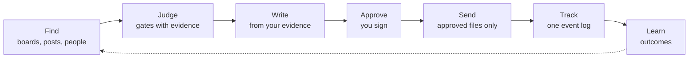
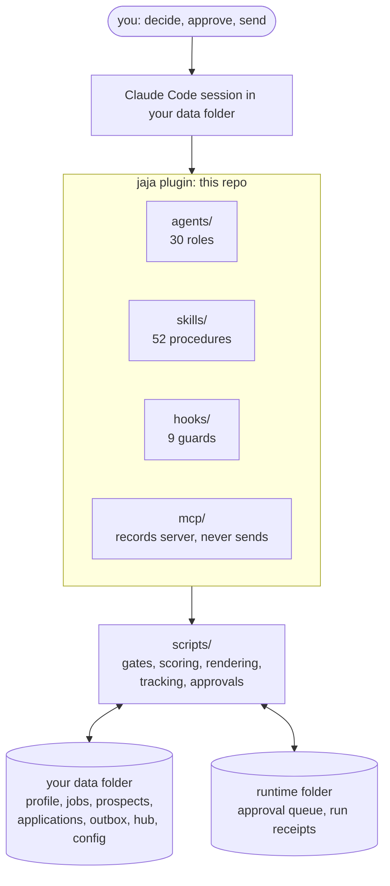
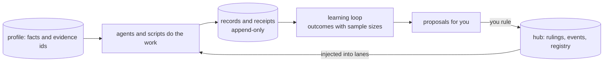

<p align="center">
  <picture>
    <source media="(prefers-color-scheme: dark)" srcset="docs/assets/logo-dark.svg">
    
  </picture>
</p>

<h1 align="center">jaja: your job agency in Claude Code</h1>

<p align="center"><b>A job-search agency for Claude Code: a team of agents that finds roles and people, gates and ranks them,
tailors pages from your own evidence and drafts every message, and never sends anything without your yes.</b></p>

<p align="center"><i>jaja is how Spanish writes laughter: because a job search deserves a smile now and then.</i></p>

<p align="center">
  <a href="https://claude.com/claude-code"></a>
  <a href="https://modelcontextprotocol.io"></a>
  <a href="https://www.python.org"></a>
  <a href="https://yaml.org"></a>
  <a href="https://github.com/openai/codex"></a>
  
  <a href="LICENSE"></a>
  
</p>

Scripts count, gate and check; models judge and draft; you decide and sign. Your profile, contacts, jobs and writing
style live in your own data folder and never touch this repository.

<p align="center"></p>
<p align="center"><sub>The dashboard on the bundled demo data (a fictional candidate). Nothing real appears in this repository.</sub></p>

## Quick start

```bash
git clone <repo-url> ~/jaja && cd ~/jaja
./install.sh --demo --yes          # synthetic demo data + a health check; nothing real, nothing sent
claude plugin marketplace add ./ && claude plugin install jaja@jaja --scope user
```

Then `cd ~/jaja-demo && claude` and try `/jaja:daily-job-plan`, `/jaja:score-fit` or `/jaja:research-company`.
The installer ends with `scripts/doctor.py`; on a clean machine it reports 0 failures. For your own search run
`./install.sh --data ~/jaja-data` (a blank skeleton) and follow [getting started](docs/guides/getting-started.md).
Requirements: macOS or Linux, Python 3.11+, Claude Code; [`uv`](https://docs.astral.sh/uv/) is recommended for the MCP server.
Optional extras (Gmail and Calendar, resume rendering, PDF checks): `pip install -r requirements-optional.txt`.

## How it works

The daily flow. Every box that touches the outside world stops at an approval you sign.



The architecture. The plugin is this repository; everything personal stays in your data folder.




## The team

30 role agents in seven teams, each defined by a card (charter, tools, autonomy tier, model, budget, KPIs). Open a team:

<details><summary><b>Find</b> (4)</summary>

| Agent | Does |
|---|---|
| `job-scout` | discovers postings from boards, feeds and alerts |
| `platform-scout` | reads platform terms and picks the allowed channel |
| `inbox-harvester` | turns recruiter and referral mail into contacts |
| `company-researcher` | builds cited company dossiers |

</details>

<details><summary><b>Judge</b> (4)</summary>

| Agent | Does |
|---|---|
| `fit-scorer` | gates and scores jobs against your evidence |
| `role-analyst` | decodes a posting into ranked needs |
| `legal-visa` | tracks work-authorization clocks and risk |
| `prospect-triage` | ranks contacts by warmth and fit |

</details>

<details><summary><b>Write</b> (10)</summary>

| Agent | Does |
|---|---|
| `resume-tailor` | builds a tailored resume from the base |
| `resume-editor` | editorial gate for truth, fit and format |
| `base-comparer` | blind A/B of a variant against the base |
| `hiring-manager-persona` | reads the page as the hiring manager |
| `technical-ai-reviewer` | checks technical claims for precision |
| `technical-recruiter-reviewer` | screens the page as the company's recruiter |
| `writer` | drafts documents and posts, never sends |
| `profile-editor` | keeps the master profile aligned and sourced |
| `linkedin-editor` | keeps LinkedIn true to the profile |
| `apply-assist` | builds and lints application packs |

</details>

<details><summary><b>Reach out</b> (4)</summary>

| Agent | Does |
|---|---|
| `prospector` | finds the warmest human path into a role |
| `messenger` | drafts every reply and follow-up |
| `negotiator` | offers: bands, comparison, scripts |
| `sender` | executes approved sends, one file at a time |

</details>

<details><summary><b>Track</b> (3)</summary>

| Agent | Does |
|---|---|
| `tracker-ops` | keeps one true event log per application |
| `mail-triage` | classifies mail and syncs the records |
| `corpus-keeper` | owns your profile records and evidence ids |

</details>

<details><summary><b>Prepare</b> (1)</summary>

| Agent | Does |
|---|---|
| `prep-coach` | interview packs, mocks and debriefs |

</details>

<details><summary><b>Run the day</b> (4)</summary>

| Agent | Does |
|---|---|
| `ops-watchdog` | routine health and silence alerts |
| `reviewer` | clean-context gate before anything is done |
| `researcher` | cited, read-only research |
| `engineer` | code work through branches and pull requests |

</details>

Around them: **52 skills** (`/jaja:<name>`), **8 lanes** (`apply`, `focused`, `hunt`, `posts`, `prep`, `recruiter`,
`research`, `resume`), **16 routines** (all disabled), **9 guard hooks** and a **24-tool MCP server**. Full lists:
[reference](docs/REFERENCE.md).

## Profile, agents and memory

| | How it works |
|---|---|
| **Your profile** | `profile/facts.yaml` and `profile/evidence.yaml` hold what you can prove, one evidence id per claim. Every resume line, answer and letter must cite an id; checks refuse a claim with no source and strings you listed as "holds". One frozen, hash-pinned base resume; a tailored variant ships only if it beats the base in a blind comparison. |
| **Agent profiles** | A role card (`agents/<name>.md`) states purpose, allowed tools, autonomy tier (T0 to T4), model, effort, budget, KPIs, stop conditions and denied commands. `scripts/kernel/sync.py` turns the cards into Claude Code agents (and optional Codex adapters) and `--check` catches drift. |
| **Memory** | Your data folder is the single source of truth: records, the hub's rulings, events and registry, append-only logs and run receipts, and the learning loop that turns outcomes into proposals. None of it lives in this repo. |



## Design nuances

What makes it different, one line each. Each is enforced by a script or hook; [docs/NUANCES.md](docs/NUANCES.md) names it.

**Safety**
- Nothing goes out without your yes: tiers T0 to T4, an approval file per outward action, denied-command hooks.
- Connectors are optional and read-only first; sending uses a separate token and a separate login.
- Pacing caps, gaps and a block-page stop protect your accounts; a block stops every lane.
- Routines ship disabled; each writes a receipt and a watchdog flags silence.

**Truth**
- Every claim on a page cites an evidence id from your own records; no source, no claim.
- Gates fail with the exact line they quoted, so you can overrule them.
- One frozen base resume; a variant ships only if it beats the base in a blind comparison.
- Missing is not empty: a check that could not run says so instead of passing.

**Structure**
- Scripts count and check, models judge and draft.
- One writer per file; lanes, an orchestrator and a hub of events and rulings coordinate sessions.
- Adapters are generated from the cards and a hook blocks editing them; one source of truth per thing.
- History is append-only: receipts, events and journals are never rewritten.
- Each role declares its tools, tier, model and budget on its card.
- A leak guard fails any commit that would carry your records into the repository.

## Engineering at a glance

| | |
|---|---|
| Tests | 5,192 tests pass on the demo data with no real data and no network; 321 test files plus 70 MCP tests |
| Scope | 142 scripts, about 76,000 lines of Python (standard library, PyYAML, requests) |
| Architecture | code, your data and a runtime folder kept apart: [architecture](docs/ARCHITECTURE.md), [design decisions](docs/DESIGN-DECISIONS.md) |
| Config seam | identity, style and policy come from config with neutral defaults; tests run as a synthetic persona |
| Health | `python3 scripts/doctor.py` checks install, config, hooks, adapters, MCP server and leak guard |

## Who it is for

For engineers and other technical job seekers who already use Claude Code and want a structured, auditable pipeline for a
long search: many roles, many people, many drafts, one true record. Not for you if you want a bot that applies for you
without review (the design refuses that), or if you do not want to keep your own evidence and records in files.

| | jaja | Prompting Claude by hand | Auto-apply bots | A tracker app |
|---|---|---|---|---|
| Approval before anything goes out | every outward action | you remember to | usually none | n/a |
| Claims checked against your evidence | yes | no | no | no |
| Auditable records you own | plain files | chat history | vendor account | vendor account |
| Setup effort | an afternoon | none | minutes | minutes |

Details and honest trade-offs: [comparison](docs/COMPARISON.md), [FAQ](docs/FAQ.md).

## Documentation

[Getting started](docs/guides/getting-started.md) · [Your first search](docs/guides/your-first-search.md) ·
[Demo walkthrough](docs/guides/demo-walkthrough.md) · [Configuration](docs/guides/configuration.md) ·
[Lanes](docs/guides/lanes.md) · [Customizing agents and skills](docs/guides/customizing-agents-and-skills.md) ·
[Architecture](docs/ARCHITECTURE.md) · [Concepts](docs/CONCEPTS.md) · [Design nuances](docs/NUANCES.md) ·
[Design decisions](docs/DESIGN-DECISIONS.md) · [Reference](docs/REFERENCE.md) · [Charter](docs/AGENCY-CHARTER.md) ·
[Connectors](docs/SETUP-CONNECTORS.md) · [Roadmap](docs/ROADMAP.md) · [Changelog](CHANGELOG.md)

## Status

Early, and used by its author for a real search. It works end to end, but expect rough edges: the layout and file formats
can still change, only Claude Code is tested (the Codex adapters are generated but not run end to end), and connectors
(Gmail, Calendar, X, a logged-in browser) are optional and off until you set them up. Respect each platform's terms; you
are responsible for what you approve and send. This project is not affiliated with Anthropic or any job platform.

## Everything on one page

The product page ends above. This is the developer depth: every agent, gate, hook, deterministic script, skill, lane, routine,
MCP tool, configuration key and nuance in the system, one collapsible section each. The tables are generated from the repository
(`python3 tools/gen-readme.py`), so every name matches a file; the guides in [docs/](docs/README.md) explain how to use them.

<!-- BEGIN GENERATED README -->

<details>
<summary><b>Agents (30): what each does, its tier cap and model</b></summary>

Each card in `agents/` states purpose, allowed tools, `tier_max` (T0 read to T4 forbidden), model, effort, budget, KPIs, stop conditions and denied commands.

| Agent | What it does | Max tier | Model |
|---|---|---|---|
| `apply-assist` | Builds and lints one apply pack per application (every answer copied from a record, with its source), keeps the portal account registry ... | T1 | sonnet |
| `base-comparer` | The regression gate, in a clean context: judges every changed bullet of a variant blind against the base line it replaces, for this JD, and ... | T0 | opus |
| `company-researcher` | Builds and refreshes the cited company dossier (companies/<slug>.md): product, team, stack, news, hiring signals, H-1B/LCA and E-Verify ... | T0 | sonnet |
| `corpus-keeper` | Owns the profile's records (profile/corpus/**, evidence.yaml, facts.yaml, profile/_inbox/): turns the owner's new work and testimony into ... | T1 | opus |
| `engineer` | Code work inside builds through branches and PRs, with CI and deploy checks | T2 | opus |
| `fit-scorer` | Settles review gates, then scores each surviving job with an A to H report and a weighted 1.0 to 5.0 score tied to evidence ids ... | T1 | sonnet |
| `hiring-manager-persona` | Reads a finished page as the hiring manager the Role Package describes, in one pass: would I call this person, which line made me want to ... | T0 | opus |
| `inbox-harvester` | Harvests every recruiter, founder, hiring-manager and referral contact from Gmail (backlog since the configured start date) and the ... | T1 | sonnet |
| `job-scout` | Runs the discovery pipeline (ATS boards, HN, Adzuna, Himalayas, alert mail), records postings the owner reads, judges what scripts cannot ... | T1 | sonnet |
| `legal-visa` | Tracks STEM OPT and EAD clocks and the unemployment-day ledger, checks each employer for E-Verify, I-983 and sponsorship risk, keeps the ... | T1 | sonnet |
| `linkedin-editor` | Keeps LinkedIn true to the approved master profile via state/linkedin/LINKEDIN.md: drafts sections with artifact proof, proof posts and ... | T3 | opus |
| `mail-triage` | Keeps the job search in sync with Gmail on each pass: incremental harvest, L0-L2 classification by script, a model review of L3 and ... | T2 | haiku |
| `messenger` | Drafts every reply, follow-up, scheduling note, thank-you and approved negotiation message to prospects (email, LinkedIn, X) in the owner's ... | T1 | opus |
| `negotiator` | From the first offer on: researches comp bands, builds the offer matrix with visa terms (E-Verify, I-983, H-1B, wage level, start-date ... | T0 | opus |
| `ops-watchdog` | Routine health, silent-failure alerts, backups, secret rotation and budget-breach alerts (their one writer) | T1 | sonnet |
| `platform-scout` | Owns targets/platforms.yaml and research/job-platforms-2026.md: reads each platform's terms, picks the allowed channel (API, alert mail ... | T1 | sonnet |
| `prep-coach` | Prepares the owner for every interview round from the corpus: prep packs (coding, system design, domain fundamentals, behavioral), STAR ... | T1 | opus |
| `profile-editor` | Owns the finalized master profile (profile/PROFILE.md): every experience, project, skill and credential in final wording, aligned end to ... | T1 | opus |
| `prospect-triage` | Scores every new or changed prospect for warmth, fit, sponsorship (a weighed signal | T1 | sonnet |
| `prospector` | Finds the warmest human path into each target role (alumni, former colleagues, people who engaged, hiring managers) from the LinkedIn ... | T1 | sonnet |
| `researcher` | Research with cited reports | T1 | sonnet |
| `resume-editor` | The editorial gate, run in a clean context: checks every resume, cover letter and why-us note for truth against the profile, alignment to ... | T0 | opus |
| `resume-tailor` | Researches each role and tailors one variant per job from the one general base resume, aligning the page truthfully to the title and the ... | T1 | opus |
| `reviewer` | Clean-context checks against a rubric | T1 | opus |
| `role-analyst` | Understands a role before anyone writes: reads the title, JD and company, picks the role lens, decodes the JD into a ranked coverage ... | T1 | sonnet |
| `sender` | Executes approved outward actions only, one approval file at a time, fully audited | T3 | haiku |
| `technical-ai-reviewer` | A senior AI engineer's read of the page: is every technical claim precise, current and defensible in a two-minute interview follow-up | T0 | opus |
| `technical-recruiter-reviewer` | The senior recruiter of THIS company hiring for THIS role, built from a researched brief: screens the page and letters against the ... | T0 | opus |
| `tracker-ops` | Keeps every application's event log true through scripts/tracker.py, the one status of the search: records applications and stage events ... | T1 | sonnet |
| `writer` | Drafts emails, posts, documents and resumes as the single writer per artifact | T1 | opus |

</details>

<details>
<summary><b>Reviewers and gates</b></summary>

Nothing reaches you until these have run, in a clean context where it matters.

| Gate | Kind | What it checks |
|---|---|---|
| `resume-editor` | agent | the editorial gate: truth against the profile, alignment, style, ATS health; signs a verdict in `review.md` |
| `base-comparer` | agent | blind A/B of every changed line against the base; reverts a line that does not win |
| `hiring-manager-persona` | agent | reads the page as the hiring manager the role package describes |
| `technical-ai-reviewer` | agent | checks every technical claim for precision and defensibility |
| `technical-recruiter-reviewer` | agent | screens the page as the company's recruiter; APPROVE or REVISE |
| `reviewer` | agent | clean-context check against a rubric; nothing is done without its verdict |
| `ai-screener` | agent (planned) | an AI-screen reader; the card is not shipped yet, so `skills/page-review` records the step as NOT RUN |
| `scripts/fit_gates.py` | script | hard gates on a job record and its JD, each failure quoting its evidence line |
| `scripts/rubric_check.py` | script | the deterministic rubric over a variant |
| `scripts/letters_check.py`, `answers_check.py`, `send_preflight.py` | script | style, length and pre-send checks from your `style.*` config |
| `scripts/check_evidence.py`, `check_holds.py`, `numbers_ledger.py` | script | evidence ids, held strings and figures on every page |
| `scripts/ats_check.py`, `page_layout_check.py` | script | what an ATS parses; layout of the rendered page |
| `scripts/screener_check.py`, `review_sign.py` | script | screener and review files are well formed and signed |

</details>

<details>
<summary><b>Hooks (9 guards)</b></summary>

| Event | Matcher | Hook | Enforces |
|---|---|---|---|
| SessionStart | any | `lane_context.py` | tells a session at start whether it is in a multi-session programme and what its role is |
| SessionStart | any | `lane_register.py` | registers the session itself in the hub registry (address, branch, role) |
| SessionStart | any | `lane_rules.py` | injects the rulings digest for this lane type |
| Stop | any | `lane_handover.py` | writes the hand-off section (changed files and sha256) into the lane's own file when a turn changes files in scope |
| Stop | any | `browser_lease.py` | each lane drives its own Chrome window, so keystrokes never land in another lane's tab |
| PreToolUse | Write\|Edit\|MultiEdit | `guard_generated_files.py` | refuses edits to files marked GENERATED by |
| PreToolUse | Write\|Edit\|MultiEdit | `lane_write_guard.py` | one writer per file: refuses a write to another lane's file |
| PreToolUse | Bash | `role_deny.py` | refuses shell commands the role card denies |
| PreToolUse | mcp__claude-in-chrome__.* | `browser_lease.py` | each lane drives its own Chrome window, so keystrokes never land in another lane's tab |
| SubagentStart | any | `role_rules.py` | injects the rulings that bind a subagent role |

Shared helpers: `lane_common.py`, `rulings_common.py`. The list is `hooks/hooks.json`; `sync.py` merges it into `.claude/settings.json` and `.codex/hooks.json`.

</details>

<details>
<summary><b>Deterministic scripts by stage (157 scripts)</b></summary>

Scripts count, gate, render, track and check; they never call a model. Cards and skills call them.

**Find** (discovery, capture and platform terms)

| Script | What it does |
|---|---|
| `fetch_ats.py` | Fetch postings from public ATS job boards and normalize them to job records (design §4, §5.1) |
| `adzuna.py` | Adzuna job search -> job records (design §4; source: adzuna). Free key, ~250 calls/day |
| `himalayas.py` | Himalayas remote-jobs API -> job records (source: himalayas; platform targets/platforms.yaml id himalayas) |
| `hn_hiring.py` | Hacker News "Ask HN: Who is hiring?" -> candidate job records (source: hn) |
| `aidevjobs.py` | AI Dev Jobs (aidevboard.com) public jobs API -> job records (source aidevjobs; platform targets/platforms.yaml id |
| `remote_feeds.py` | Remotive and RemoteOK public APIs -> job records (sources remotive, remoteok; platforms.yaml ids remotive ... |
| `yc_boards.py` | YC startups -> their public Ashby, Greenhouse or Lever board -> targets/companies.yaml |
| `alert_boards.py` | employers named in job-alert cards -> their public Greenhouse, Ashby or Lever board -> proposals |
| `job_alerts.py` | Job-alert emails from the classified Gmail harvest -> job records (research/job-platforms-2026.md) |
| `feed_watch.py` | the dream companies' engineering-blog and careers feeds, read by fixed rules |
| `news_watch.py` | The page watch: listing pages that have no board API, and news pages that signal hiring |
| `funding_signals.py` | SEC EDGAR as a hiring signal: new Form D raises by target companies, and AI/ML keyword hits |
| `pipeline.py` | The daily deterministic discovery harness (routine js-scout) |
| `discover_companies.py` | new companies found deterministically |
| `scout_board.py` | the day's handed-over roles as one ranked table, generated from the job records, so the day's |
| `scout_coverage.py` | how much of the known job surface the scouts checked on a day, and what they found |
| `scout_review.py` | Close job-scout's review by script: re-gate ghost keeps that lack their proof, then count passed_gates |
| `platform_watch.py` | the monthly sweep for new job-search MCP servers |
| `platform_yield.py` | Per-platform yield and the platform registry check (targets/platforms.yaml; owner platform-scout) |
| `jd_capture.py` | capture the JD of every open job at or above the hunt cut, only through channels whose terms allow |
| `web_snapshot.py` | Firecrawl (firecrawl.dev) behind our own guards: public pages to dated evidence snapshots |
| `ats_detect.py` | recognise the board vendor of each target the scouts cannot read yet |
| `x_api.py` | X (Twitter) for the job search through the official X API. Reads are budgeted; every write waits for the owner |
| `jobs_manual.py` | Record a posting read by hand in the browser (skill browser-job-search) as a job record |

**Gate and score** (hard gates with evidence, fit and ranking)

| Script | What it does |
|---|---|
| `fit_gates.py` | Deterministic hard gates on a job record + its JD text (design §2 fit-scorer, targets/roles.md §3-4, §8) |
| `hunt_score.py` | The hunt triage score: a deterministic 0 to 100 on every open job, so the best finds surface within hours |
| `hunt_review.py` | The daily fresh-roles review: every new find since the last review, ranked, with its next action |
| `hunt_lessons.py` | the loop, read only: what the Scout learned today and whether SETUP answered it |
| `employer_regate.py` | a dry run of the real-employer gate over the applications we already have |
| `h1b_lookup.py` | Employer sponsorship enrichment from cached USCIS H-1B and DOL LCA data (design §4, research §8) |
| `dedup.py` | Dedup keys, cross-source duplicates, repost detection, the seen ledger and ghost scores (design §4) |
| `fresh10.py` | the day's ten freshest roles worth a page, for the focused lane |
| `fresh10_people.py` | one named person per Fresh 10 role, every day |
| `experience_months.py` | the one months-of-experience count every fit report cites (charter section 13 [5]) |
| `jd_matrix.py` | the coverage matrix skeleton: every JD line, typed and ranked, with candidate evidence ids |
| `role_taxonomy.py` | the market's role categories, measured from the hunt's own job records |
| `profile_route.py` | a job title -> its profile base -> the resume PDF a mass application sends |
| `profile_titles.py` | the render-safe title of a profile/facts.yaml entry  |
| `focus_profiles.py` | one profile per role focus, picked by title, each with its best foot forward |
| `segment_companies.py` | targets/companies.yaml `segment` (startup, growth, big-tech, ai-lab, enterprise) from |
| `company_slugs.py` | keep every stored company_slug on the one canonical slug (company_index.py) |
| `company_index.py` | one company slug per company, so every join finds the dossier, the people and the roles |
| `companies_set.py` | the one setter for the watchlist fields scripts discover (targets/companies.yaml) |
| `reader_model.py` | check a Role Package's Reader model (section 6) before anyone writes the page |
| `stale_check.py` | is a role's package still about the posting we will apply to? Checked before anyone writes |
| `stale_signatures.py` | every page whose sign-off no longer matches the page, with a re-sign or retire call |

**Evidence, pages and checks** (claims, rendering, lints and gates on every page)

| Script | What it does |
|---|---|
| `render_resume.py` | Render a resume YAML to an ATS-safe one-page PDF (and a DOCX for Workday), with a strict |
| `ats_check.py` | ATS check for a resume PDF: what an applicant tracking system will read (design section 4) |
| `page_layout_check.py` | the rendered page, measured. Every other gate reads words; this one reads the page |
| `check_evidence.py` | validate evidence references across profile/ |
| `check_holds.py` | held text (profile/PROFILE-HOLDS.md) in any file, with the Markdown blind spots closed |
| `check_dossier.py` | the company-researcher's citation audit of a dossier, as a script |
| `check_records.py` | every department record parses; otherwise the file, line and error are named |
| `numbers_ledger.py` | the numbers of a governed employer render only from the ledger's measured, released rows |
| `rubric_check.py` | the deterministic half of the resume rubric (R3 section B: B3 B4 B5 B7 B9 B12 B13 B14 B18) |
| `letters_check.py` | the form of a cover letter, a why-us answer and an anything-else note |
| `screener_check.py` | validate the AI screener's resumes/variants/<slug>/screener.md |
| `base_drift.py` | was this variant cut from the base that ships today? (trust test 2026-10-01, F71) |
| `blind_pairs.py` | make the base comparison blind, then reveal it |
| `review_sign.py` | sign an editor's review.md without hand-editing its front matter |
| `build_linkedin_md.py` | Build state/linkedin/LINKEDIN.md from the approved texts (state/linkedin/approved/*.txt) and the skills map |
| `skills_map.py` | The approved skills list: name -> (evidence ids, role families), read from the config |
| `answers_check.py` | the gate on the form-answer bank, profile/answers/<family>.md |
| `apply_pack.py` | every answer an application form asks, copied from a record, one pack per application |
| `apply_batch.py` | the batch path for the mass tier: many applications at once, one sheet |
| `stage_batch.py` | Stage a LinkedIn approval batch from approved texts, and write the apply list from the same drafts |
| `mass_page.py` | the mass-tier page for one role, end to end, with no model call (resume-for --tier mass, step 4m) |
| `mass_prep.py` | make scored mass-tier JOBS ready for the mass apply batch: an application folder and a |
| `corpus_audit.py` | the corpus-keeper's periodic audit of profile/ (read only) |
| `evidence_slice.py` | the part of the owner's record one role needs, so writers and judges stop reading all of it |
| `motif_check.py` | repeated phrasing on a page (editorial-review step 3): n-grams and hyphenated compounds used 3 or |
| `credential_check.py` | one detector for credentials in free text |
| `cite_sample.py` | citation support sampling for Role Packages (the orchestrator design section 7) |

**People and outreach** (contacts, drafts, approvals' inputs and mail)

| Script | What it does |
|---|---|
| `prospects.py` | The job-search CRM: one markdown file per person in prospects/ (schema schemas/prospect.yaml) |
| `outbox.py` | Outbound drafts and their approval files. Nothing here sends anything |
| `send_preflight.py` | Send preflight and read-back: nothing goes out until the text and the transport pass |
| `follow_ups.py` | the one daily follow-up list the recruiter lane runs |
| `network_plan.py` | the day's network plan |
| `network_map.py` | the whole network, classified. Read-only on records |
| `people_traces.py` | the public traces a role-analyst reads for a Reader model's "the people" bullet |
| `people_watch.py` | The people watch: the people who post about hiring, watched on X and read on LinkedIn |
| `gmail_pull.py` | Gmail harvest (read-only) and Gmail draft creation from approved approvals |
| `gmail_send.py` | Approval-gated Gmail sends and drafts with local attachments. Nothing sends without the owner's approved file |
| `gmail_auth.py` | Google OAuth for the job-search scripts: installed-app flow, split tokens, stored outside the repo |
| `mail_classify.py` | Classify harvested mail with the L0-L3 ladder (cheapest rule first, a model only when unsure) |
| `mail_events.py` | Mail-event rows for tracker-ops and mail-triage's Handoffs checklist. Scripts enforce, the model judges |
| `mail_intake.py` | Mail intake: the hourly collector that carries Gmail into the tracker (pull, classify and match mail into the |
| `calendar_events.py` | Your Google Calendar for the job search: read it, invite guests, change and cancel what this system created |
| `calendar_hold.py` | Tentative Google Calendar holds for interviews. Never invites anyone |
| `linkedin_export.py` | Parse LinkedIn's official "Download your data" export into normalized people and touches |
| `graph_links.py` | the knowledge-graph edges on job-search records, so a notes vault (Obsidian) can draw them as a |
| `build_graph.py` | the tracking graph: companies, roles, people and connections, joined from the records |
| `pending_triage.py` | A dry-run proposal for the postings parked in jobs-pending/. Writes nothing in jobs/ |
| `reclassify_safe.py` | re-run the mail classifier over stored harvest files without losing resolve answers |
| `posts.py` | Hiring posts on LinkedIn and X, one pipeline: the latest posts in; structured records, people and |
| `posts_sweep_check.py` | The posts lane's morning sweep file, checked |
| `everify_note.py` | Record the owner's manual E-Verify Employer Search lookup in legal/checks/<company>.md, in one command |
| `interviews.py` | the one number the agency is aimed at |
| `prep_focus.py` | the first prep pack for any screen, in one command |

**Track, report and learn** (the one record, the day, the numbers and the learning loop)

| Script | What it does |
|---|---|
| `tracker.py` | Application tracker: append-only event log, stage projection, ghost flags, metrics |
| `pursuits.py` | the pursuit record: one direction into one company, and the only writer of pursuits/*/pursuit.md |
| `pursuit_hub.py` | pursuits/<slug>/HUB.md: one page per pursuit, a deterministic join over every record it names |
| `role_hub.py` | The per-role record hub: one generated applications/<slug>/HUB.md per application, tracking a role's company, |
| `dashboard.py` | Render the job-search dashboard: DASHBOARD.md (for the owner and HOME) + state/dashboard.json (machines) |
| `day_queue.py` | the day's ranked work queue the lanes claim from (agency charter §4: lanes are personas; each reads |
| `next_up.py` | NEXT-UP, the one ranked list of every role worth the owner's next hour, generated. It replaces a hand-kept table ... |
| `evening_wrap.py` | the evening wrap: one file a day, |
| `recruiter_sweep.py` | the morning sweep LISTING: everything new since the last sweep, from files |
| `agency_status.py` | the job-search agency's health in at most 15 lines, for the daily brief. Read only |
| `channel_report.py` | the weekly channel report (agency charter 0.1 item 7, section 13): which way in gets screens |
| `finding_metrics.py` | how complete and how early is our role finding |
| `strategy_review.py` | the Lead Recruiter's daily strategy numbers: what worked, and rule flags. Reads the records; |
| `lessons.py` | what the agency learned, read in code: the Recruiter's ledger |
| `learn.py` | the shared learning record: every role and lane writes what it learned |
| `cards.py` | the morning flashcards (agency charter §3 steps 3-5): the sweep's items ranked, each with why it matters, |
| `bundle.py` | pursuits/<P>/BUNDLE.md: the one page the owner reviews before approving anything on a pursuit |
| `clock.py` | The job-search clock (a fixed number of days from a start date): clock.yaml is the single source of truth; this ... |
| `portal_digest.py` | the morning brief's one line per portal. Read only |
| `portal_report.py` | one line per portal, and every job seen on more than one portal |
| `portal_registry.py` | targets/platforms.yaml is the one source per portal |
| `portal_sitting.py` | the prep for one portal sitting with the owner present. Writes |
| `sitting_order.py` | the ONBOARDING sittings ranked by expected interviews per hour of the owner's time |
| `check_portals.py` | the agency's portal setup is done only when this exits 0 |
| `presence_check.py` | every public surface says the current truth, and nothing that arrives there goes unwatched |

**Pacing, safety and policy** (caps, block-page stops, run guards, rulings and model policy)

| Script | What it does |
|---|---|
| `pace.py` | the hard daily counter for outward acts on LinkedIn and X (human pace) |
| `browser_pace.py` | the guard before every browser read of a careers site |
| `browser_research.py` | the guardrails a script can hold for reading people in the owner's browser |
| `run_guard.py` | a run that hangs ends itself, with its stack on disk and a true failed receipt (SETUP-FINAL A1, A2) |
| `rulings.py` | record the owner's rulings once, verbatim, with an id nobody else holds |
| `routine_drift.py` | does each installed scheduled task still run what its routine spec says (SETUP-FINAL A7)? |
| `model_policy.py` | every agent runs on the model and effort its kind of work needs |
| `card_audit.py` | a read-only audit of the department's specialists: each role, lane and skill card should be |
| `gate_versions.py` | the version (sha256, first 12) of every page gate script, one line, for NOTES `## Gates` |
| `effort.py` | the one-line effort level (E1 to E5) of a role, for the Recruiter's cards and queue builders (W4) |
| `charter.py` | print only the sections of AGENCY-CHARTER.md a lane needs, plus the goal and the safety lines |
| `connectors_doctor.py` | Connector health for the job-search department: one record per connector, never a secret |
| `doctor.py` | is this install healthy? One line per check, then a summary. Read-only; no network |
| `agency_paths.py` | Where the agency's code and your data live. Stdlib only; imported first by js_common and the entry scripts |
| `agency_config.py` | The owner's policy, style and identity values. The code ships neutral defaults; your values live in your data ... |
| `js_common.py` | Shared helpers for the job-search department scripts |
| `js_comms_util.py` | Shared helpers for the job-search communications/CRM scripts |

**Other scripts**

| Script | What it does |
|---|---|
| `rollcall.py` | the the orchestrator roll call from files, and GO as an event, instead of check-in messages |

**Kernel** (`scripts/kernel/`: adapters, lint, approvals, hub tools, receipts)

| Script | What it does |
|---|---|
| `approvals.py` | the one implementation of the approval rules (schemas/approval.yaml, templates/approval.md) |
| `context_budget.py` | measure the context every session is forced to load before it does any work |
| `evals.py` | Agent eval harness for the job agency |
| `frontmatter.py` | YAML frontmatter for the agency kernel |
| `hub_events.py` | the hub's event feed: one JSON line per ruling, park, go or order change, and SIGNAL.md made from it |
| `lane_state.py` | the small live state of a lane, extracted from its append-only hub lane file |
| `lint.py` | validate the agency's files. Prints findings, returns their count |
| `nightly_sweep.py` | the nightly sweep as one deterministic command (an optional routine; none ships enabled) |
| `redact.py` | Redact secret-shaped strings in text files in place |
| `roots.py` | The three roots the kernel scripts work against, as one small value |
| `rulings_digest.py` | the rulings digest a lane or role sees at start, and the words of any ruling on demand |
| `sweep.py` | rebuild the status briefing (HOME.md / HOME.json) and the registries from files |
| `sync.py` | regenerate the engine adapters from the canonical files of this repo |
| `token_ledger.py` | measured token use per session, subagent type and model, read from Claude Code transcripts |
| `watchdog.py` | catch routines that went silent |

</details>

<details>
<summary><b>Skills (52): invoked as `/jaja:<skill>`</b></summary>

| Skill | Use it when |
|---|---|
| `add-experience` | Use in the owner's resume session, whenever the owner describes new work (a job, role, project, award, talk, or a date or title change), or for the ... |
| `apply-assist` | Use when an application row is ready (the base, or a variant that won): build and lint its apply pack, fill the employer-site form from the pack in ... |
| `apply-sprint` | Use when the owner approves a big push (for example 20 applications in one sprint) that is too large for one session and must run as a lane programme ... |
| `ats-check` | Use after every resume PDF render, before the editorial verdict is signed, when a vendor parse (Workday, Greenhouse, Lever, Ashby, iCIMS, Taleo ... |
| `base-compare` | Use after a variant renders and before anyone reads it: judges every changed bullet and order blind against the current base for this JD (shuffled ... |
| `browser-job-search` | Use only when the owner is present and wants to search job boards in the owner's browser (LinkedIn, Wellfound, HiringCafe, WTTJ, YC, Glassdoor ... |
| `build-resume-base` | Use only when the owner orders a change to the one general base resume (resumes/bases/general/: new work, a ruling) or asks for a base designed for a ... |
| `build-resume-pdf` | Use when a resume YAML (a variant of the general base, or a base change the owner ordered) needs its PDFs (and a DOCX for Workday), when the page ... |
| `calendar-hold` | Use when mail-triage finds an interview invite or scheduling email with proposed times, or the owner confirms a slot in a thread, to request a ... |
| `connector-search` | Use in a session where the owner has added the Indeed, ZipRecruiter or Dice connector in Claude: run the shared alert queries through each ... |
| `corpus-audit` | Use weekly (before the weekly review), the day the owner rules on profile conflicts, and after an add-experience batch: evidence ids resolve, every ... |
| `daily-job-plan` | Use each morning (js-morning-brief, or when the owner starts the Recruiter) and evening (js-evening-review), or when the owner asks what the job ... |
| `debrief` | Use right after an interview round or recruiter call, when the owner reports how it went, or when interview feedback or a rejection reason arrives ... |
| `doctor` | Use when something looks off (stale status, broken link, drift between a card and its generated agent), after any workshop skill, before a commit, or ... |
| `draft-reply` | Use when a reply batch plan is ready in state/batches/, when a prospect has written back and needs an answer, or when a thank-you or an approved ... |
| `editorial-review` | Use when a resume variant (or a change the owner ordered to the general base), cover letter or why-us note is ready for the editorial gate, after the ... |
| `follow-up-sweep` | Use each morning (routine js-follow-up-sweep) or when the owner asks who is waiting on a nudge, to draft the human nudges due at 4 and 9 business ... |
| `gmail-sync` | Use when the owner, the Recruiter's sweep or a daily check starts a mail pass (mail_intake.py), right after reply batches go out, or when the owner ... |
| `harvest-inbound` | Use for the one-time Gmail backlog harvest (inbound mail since a start date the owner names) or the weekly safety-net pass over the week's harvested ... |
| `hunt-daily` | Use each morning after the fresh-roles review (js-hunt-review), when the owner asks what new roles came in, or when the dashboard's Fresh roles ... |
| `job-dashboard` | Use when DASHBOARD.md or the job-search metrics must be refreshed, when the owner asks where the search stands, after a batch of tracker events, or ... |
| `lane` | Use when work is split across more than one session: starting/resuming an orchestrator, a lane or a sub-lane, handing work between sessions, or ... |
| `lane-orchestration` | Use whenever work on any project is split across more than one session: starting or resuming an orchestrator, a lane or a sub-lane |
| `letters` | Use when an application asks for a cover letter, a 'why are you interested in <company>' answer or an 'anything else you'd like to share' field: the ... |
| `linkedin-assist` | Use when the owner prefers to send approved LinkedIn items personally (the hand-off mode |
| `linkedin-draft` | Use when the owner wants a LinkedIn profile section, a proof post or a comment drafted, when the approved master profile changes, or on the first ... |
| `mock-interview` | Use only when the owner asks for a mock interview or practice round (coding, LLM and agent system design, ML fundamentals, behavioral), usually from ... |
| `network-daily` | Use on a weekday in the Recruiter's day, or when the owner asks who to connect with or what to comment on: builds the day's network plan (connection ... |
| `new-automation` | Use when something should happen in reaction to an event (session start or end, a tool call, a file change, a new inbox item, a routine finishing, a ... |
| `new-role` | Use when the owner wants to hire a new agent role (agency-wide or project-owned) or asks whether something should be a role at all |
| `new-routine` | Use when something must happen on a schedule (cloud, GitHub Actions or the desktop app) or the owner asks to automate a recurring job |
| `new-skill` | Use when a procedure has been repeated by hand twice, or the owner asks to add a skill to the agency or a project |
| `orchestrate` | Use when work is split across more than one session: starting/resuming an orchestrator, a lane or a sub-lane, handing work between sessions, or ... |
| `page-review` | Use when a variant has passed the scripts, the editor and base-compare: runs the layout gate, then four readers in clean contexts (hiring-manager ... |
| `parse-linkedin-export` | Use when a new LinkedIn data export has been unzipped into profile/_inbox/linkedin-export/, or the owner asks how to request one, so LinkedIn ... |
| `platform-watch` | Use monthly (js-platform-watch), when the owner names a job platform or tool, or when the alert review list shows an unmapped sender, to vet ... |
| `prep-pack` | Use when an application reaches screen, oa, interviewing or final, when an interview invite lands, or when the owner asks to prepare for a specific ... |
| `prospect-search` | Use within 24 hours of an application reaching applied, when a dream or strong target company has a fresh fit role and no warm path yet, or when the ... |
| `research-company` | Use when a queued application's company dossier is missing or older than 30 days, before an interview round, when the owner names a company, a role ... |
| `research-person` | Use when one person must be found and understood before any outreach: the exact person verified across two independent sources, what they build and ... |
| `resume-for` | Use when the owner, the Recruiter or a lane wants the page for one role, at one of three depths (charter): dream (full pipeline), focused (package ... |
| `role-package` | Use when a role is chosen and needs to be understood before any resume is written: the role-analyst picks the lens, decodes the JD into a ranked ... |
| `score-fit` | Use when a job in jobs/ has passed the hard gates or was sent to review and needs a fit report, when the owner asks whether a specific role is worth ... |
| `scout-jobs` | Use when the js-scout routine runs, when the owner asks for fresh AI/ML postings, or when targets/companies.yaml or sources.yaml changed and the job ... |
| `setup-job-alerts` | Use when the owner sets up or changes job alerts on a platform (the one-time steps per platform in targets/platforms.yaml), or when a platform's ... |
| `sota-watch` | Use monthly (js-sota-watch) or when the owner asks what changed in agentic engineering tools or AI/ML hiring, to propose approval-gated updates to ... |
| `sync` | Use after editing any role card, skill, hook, MCP config or AGENTS.md, and whenever the doctor reports drift |
| `tailor-resume` | Use when an application is queued (fit at or above the queue threshold in the policy config, or the owner's override) and needs a tailored resume ... |
| `track-application` | Use when anything happens to an application: the owner says they applied, an email or calendar event arrives, a stage changes, a round is scheduled ... |
| `triage-prospects` | Use after a harvest adds prospects at status new, when a prospect's record changes with new inbound, or each morning before the reply batch, to score ... |
| `visa-check` | Use when a company, job or offer raises a work-authorization question (sponsorship wording, E-Verify, I-983, remote worksite, start date), when the ... |
| `x-channel` | Use for anything on X (Twitter): read a post and its replies count, look up a person, search or run the hiring watch list, or prepare a follow, DM ... |

</details>

<details>
<summary><b>Lanes (8)</b></summary>

A lane is a long-lived session with a charter, a roster and a scope; launch it with `claude --agent lane-<type> --settings <repo>/.claude/lane-settings/<type>.json`.

| Lane | Title | Agents it uses |
|---|---|---|
| `apply` | Apply lane | apply-assist, tracker-ops, messenger, legal-visa |
| `focused` | Focused lane | role-analyst, company-researcher, prospector, messenger, resume-tailor, resume-editor, base-comparer, technical-recruiter-reviewer, technical-ai-reviewer, hiring-manager-persona, legal-visa, tracker-ops, apply-assist |
| `hunt` | Hunt lane | job-scout, platform-scout, prospector, company-researcher, fit-scorer, legal-visa, messenger |
| `posts` | Posts lane | prospector, messenger |
| `prep` | Prep lane | prep-coach |
| `recruiter` | The Recruiter | role-analyst, fit-scorer, tracker-ops, corpus-keeper, legal-visa, messenger, prospector, job-scout, company-researcher |
| `research` | Research lane | role-analyst, company-researcher, prospector, fit-scorer, legal-visa |
| `resume` | Resume lane | resume-tailor, resume-editor, base-comparer, hiring-manager-persona, technical-ai-reviewer, technical-recruiter-reviewer, ai-screener, corpus-keeper, role-analyst, company-researcher, prospector, fit-scorer, legal-visa |

</details>

<details>
<summary><b>Routines (16, all disabled by default)</b></summary>

| Routine | Schedule (cron) | State | What it does |
|---|---|---|---|
| `js-apply-batch` | `15 8 * * 1-5` | off | Retired (charter section 7: the apply lane does this work after the owner's batch yes) |
| `js-backlog-harvest` | `30 7 * * 1` | off | Every week, run the safety-net harvest of the week's recruiter, founder and hiring-manager mail (and a new ... |
| `js-evening-review` | `30 18 * * 1-5` | off | On weekday evenings run python3 scripts/evening_wrap.py --write: the one evening file ... |
| `js-follow-up-sweep` | `0 8 * * 1-5` | off | On weekday mornings, draft the nudges that are due (the cadence in charter section 6 and config/defaults.d |
| `js-h1b-cache-refresh` | `0 5 1 * *` | off | Monthly, refresh the USCIS H-1B cache, re-enrich job records and re-verify every board token in the watchlist |
| `js-hunt-boards` | `0 7-22/3 * * *` | off | Every few hours during the day poll every company board (Greenhouse, Lever, Ashby, Workday, Jibe, sitemaps ... |
| `js-hunt-review` | `30 7 * * *` | off | Each morning capture every JD a terms-safe channel reaches (jd_capture.py, no Firecrawl), re-score, then ... |
| `js-hunt-signals` | `0 7 * * *` | off | Each morning read the day's hiring signals: SEC Form D raises by watch-list and AI companies (funding) and ... |
| `js-hunt-x` | `0 8 * * 1-5` | off | On weekday mornings search X through the official API for new hiring posts (targets/x-watch.yaml: the hiring ... |
| `js-mail-triage` | `0 7-22 * * *` | off | Hourly during the day, classify new job-related mail with the L0 to L3 ladder, match pipeline mail to ... |
| `js-morning-brief` | `45 6 * * *` | off | Each morning run the first half of the Recruiter's day (docs/AGENCY-CHARTER.md section 3), records only and ... |
| `js-platform-watch` | `0 7 3 * *` | off | Monthly, check the job-platform registry, write each platform's 30-day yield, re-read terms that are due, vet ... |
| `js-presence-watch` | `0 8 * * 1` | off | Weekly, check that each public surface in state/presence/portals.yaml says the current truth and is watched ... |
| `js-scout` | `0 6 * * *` | off | Each morning refresh the outbound job feed (ATS boards, Adzuna, the HN thread on days 1 to 5), dedup, enrich ... |
| `js-sota-watch` | `0 7 2 * *` | off | Monthly, research what changed last month in agentic engineering (Claude Code, Agent SDK, Codex, MCP, Agent ... |
| `js-weekly-metrics` | `0 16 * * 0` | off | On Sundays regenerate the dashboard and write the weekly funnel report: interviews booked this week against ... |

</details>

<details>
<summary><b>MCP server: 24 tools (20 read, 4 write; none sends)</b></summary>

Run with `uv run --directory mcp job-search-mcp`; registered in `.mcp.json`. Text from postings and mail comes back inside `<untrusted_*>` tags and is data, never instructions.

| Tool | Kind | What it does |
|---|---|---|
| `jobs_search` | read | Search normalized job postings in jobs/ (one compact row per job, no JD text) |
| `job_get` | read | One job: its full frontmatter (company, title, sponsorship, fit, status, URLs) plus the JD text |
| `portals_list` | read | List every job portal in the one registry: id, name, control channel |
| `portal_get` | read | One portal from the registry: its row (as portals_list), the setup checklist the owner follows (alert_setup), |
| `job_sightings` | read | One job across portals: the canonical record (a duplicate points to it), every portal it was seen on |
| `reader_model_get` | read | The Reader model of one role, from its Role Package research/targets/<slug>.md section 6: who reads |
| `focus_profile_get` | read | How the owner presents for one role focus: pass a profile family (a lens family name |
| `network_for` | read | Who in the owner's network can help at a company, or everyone of one role kind: pass a company name |
| `prospects_list` | read | List CRM prospects (recruiters, founders, hiring managers, referrers) filtered by CRM metadata |
| `prospect_get` | read | One prospect: full CRM frontmatter, the last `timeline_limit` Timeline lines and the newest |
| `applications_list` | read | List applications (applications/<slug>/application.md), newest update first |
| `application_get` | read | One application: frontmatter, the last `events_limit` events of its append-only log, the fit |
| `application_hub` | read | The per-role record for one application: the opening (live or closed), the company dossier, the |
| `pursuits_list` | read | List pursuits (pursuits/<slug>/pursuit.md): one direction into a company each (a referral through one |
| `pursuit_get` | read | One pursuit: its record (company, referrer, introducer, contacts, picks, master resume, stage, what it |
| `touches_recent` | read | Recent touches (every message in or out, from touches/YYYY-MM.jsonl), newest first |
| `dashboard_metrics` | read | Headline numbers for the department in one call: the application funnel and response rates |
| `profile_facts` | read | the owner's canonical facts from profile/facts.yaml (names, dates, titles, degrees, links, conflicts), |
| `evidence_lookup` | read | Resolve evidence ids (profile/evidence.yaml) to their source, locator and note, or search them |
| `resume_variants_list` | read | List resume bases (resumes/bases/<lens>/) and tailored variants (resumes/variants/<slug>/) from |
| `prospect_set` | write | Update one CRM prospect record (or create it with create=true), validated against the prospect |
| `tracker_event` | write | Append one event to an application's log through scripts/tracker.py (the single writer), which |
| `outbox_create` | write | File one outbound DRAFT through scripts/outbox.py (outbox/O-<year>-<NNNN>.md, status |
| `approval_create` | write | File a PENDING approval request in work/approvals/ for the owner. It does not approve, send, draft |

</details>

<details>
<summary><b>Architecture and data layout</b></summary>

```
code root (this repo)        data root (your folder)           runtime root
agents/ skills/ hooks/       profile/  jobs/  prospects/       work/approvals/   (the approval queue)
scripts/ mcp/ dashboard/     applications/  outbox/  state/     logs/runs/        (run receipts)
schemas/ templates/ config/  hub/  targets/  config/  views/   vault/            (secret pointers)
```

- **Plugin.** The repository root is the Claude Code plugin (`.claude-plugin/plugin.json`): skills from `skills/`, agents from `agents/`
  (each card carries native `description` and `tools` fields that `sync.py` keeps in step), hooks from `hooks/hooks.json`, the MCP server from `.mcp.json`.
- **Roots.** `scripts/agency_paths.py` resolves the three roots: `JAJA_DATA` (or `JOB_SEARCH_ROOT`, then `~/.config/jaja/config.yaml`), `JAJA_RUNTIME`
  (default `<data>/runtime`), under tests or `JAJA_DEMO=1` the bundled demo. `scripts/js_common.py` is the shared record library.
- **Config seam.** `scripts/agency_config.py` reads `identity`, `style` and `policy` from `config/defaults.d/*.yaml` (neutral defaults), overlaid by your
  `<data>/config/*.yaml`; under pytest a synthetic persona (`scripts/tests/persona.d`) is used instead.
- **Generated adapters.** `scripts/kernel/sync.py` renders `agents/` to `.claude/agents/` and `.codex/agents/`, lanes to `lane-<type>` agents with
  settings in `.claude/lane-settings/`, skills to `.agents/skills/`, and merges hooks and MCP config; `--check` reports drift.
- **Hub.** Lane sessions coordinate through `<data>/hub/`: `programme.json`, `registry.json`, `events.jsonl`, `rulings.yaml`, `lanes/`, `briefs/`.

Your data folder (`tools/init-data.py` creates it; it never overwrites a file):

```
profile/      facts.yaml  evidence.yaml  PROFILE.md  VOICE.md (blank)  skills-taxonomy.yaml  corpus/  answers/
resumes/      one base resume + a folder per tailored variant        jobs/ jobs-pending/   discovered postings with gate results
applications/ per-application fit report, pack and events            prospects/ graph/ touches/   people, graph, every touch
outbox/       drafts waiting for approval                             pursuits/   company-level campaigns
targets/      roles.md  platforms.yaml  fit-gates.yaml  post-queries.yaml  x-deny.yaml  x-watch.yaml  mass.yaml  goals.yaml
state/        reports, learning loop, presence, browser logs          hub/        orchestration files
config/       identity.yaml  style.yaml  policy.yaml                  views/      optional Obsidian Bases tables
sources.yaml  discovery channels (at the data root)                   legal/      your own work-authorization timers (optional)
```

</details>

<details>
<summary><b>Configuration keys</b></summary>

Every key the code reads has a neutral default in `config/defaults.d/*.yaml`; override any of them in `<data>/config/*.yaml` (files merge in name order). Number in brackets: sub-keys.

| Section | Keys | Names |
|---|---|---|
| `identity` | 19 | `account_emails`, `degrees_held`, `emails`, `linkedin_url`, `name`, `name_variants`, `owner_aliases`, `owner_handles`, `owner_label`, `owner_speaker`, `owner_token`, `resume_file_pattern`, `resume_pdf_name`, `schools`, `signature_names`, `signature_urls`, `timezone`, `timezone_label`, `vault_prefix` |
| `style` | 14 | `ai_tell_density`, `ai_tell_words`, `banned_phrases`, `banned_words`, `greeting`, `letters` (2), `no_em_dash`, `no_en_dash`, `owner_label`, `pitch_phrases`, `resume_section_order`, `resume_slop_words`, `send` (1), `signoffs` |
| `policy` | 43 | `apply` (7), `browser` (4), `browser_lease` (1), `cockpit` (2), `connectors` (1), `dossier` (1), `employer` (2), `fit_gates` (4), `focus` (1), `fresh10` (4), `hunt` (13), `jd_capture` (2), `lane_aliases`, `lenses`, `letters` (3), `linkedin_batch` (4), `linkedin_doc` (7), `location` (6), `mail` (2), `nda` (1), `nda_terms`, `network` (4), `numbers_ledger` (3), `outreach` (8), `pace` (3), `people` (1), `platforms` (2), `portal_sitting` (6), `posts` (4), `prep` (2), `profile_route` (1), `prospects` (7), `ruling_id_pattern`, `salary`, `search` (7), `segments` (1), `send` (2), `skills_map` (1), `sponsorship` (1), `strategy` (8), `tiers` (2), `title_filter` (3), `years_gate` |

</details>

<details>
<summary><b>Design nuances and the code that enforces each</b></summary>

The one-line claims in the README, each with the code that enforces it. If a line here stops being true, the README is
wrong: fix the code or the claim.

#### Safety

| Nuance | Where it is enforced |
|---|---|
| Nothing goes out without your yes. Tiers T0 (read) to T4 (forbidden); every outward action is an approval file. | Each role card states `tier_max` (`agents/*.md`, schema `schemas/role.yaml`). `scripts/kernel/approvals.py` writes and verifies approval files (they expire after 7 days). `scripts/outbox.py can-send` refuses anything not approved; the `sender` card is the only one that executes sends. |
| Denied commands cannot be run by a role that must not run them. | Cards list `deny_commands`; the PreToolUse hook `hooks/role_deny.py` blocks them (listed in `hooks/hooks.json`). |
| Connectors are optional and read-only first; sending uses a separate token and login. | `scripts/gmail_auth.py` keeps separate read, compose and send tokens (`login`, `login --compose`, `login --send`); tokens live in `~/.config/jaja/`, never in the repo. Setup: `docs/SETUP-CONNECTORS.md`. |
| Pacing caps, gaps and a stop on a block page. | `scripts/pace.py` (daily caps and gaps per platform, from config `policy.pace.*`), `scripts/browser_pace.py` (a 429 or block page stops all lanes), `hooks/browser_lease.py` (one keyboard on a shared browser). |
| Routines ship disabled, write receipts, and a watchdog flags silence. | Every `routines/*.yaml` has `enabled: false`; `scripts/kernel/lint.py` flags an enabled model routine without `enabled_by`; `scripts/kernel/watchdog.py` compares the newest receipt in `<runtime>/logs/runs/<name>/` with the schedule. |

#### Truth

| Nuance | Where it is enforced |
|---|---|
| Every claim cites an evidence id from your records. | `scripts/check_evidence.py` validates the evidence registry and citations; `scripts/render_resume.py` lints `missing-evidence` and `unknown-evidence`; `scripts/numbers_ledger.py` and `scripts/check_holds.py` check figures and strings you listed as holds. |
| Gates fail with the exact line they quoted. | `scripts/fit_gates.py` writes `gate`, `gate_reasons` and `gate_evidence` on each job record. |
| One frozen base resume; a variant ships only if it beats the base in a blind comparison. | Base files are hash-pinned (`SHA256.txt`, read by `scripts/apply_batch.py` and `scripts/profile_route.py`); `scripts/base_drift.py` finds variant lines from an older base; `scripts/blind_pairs.py` and `skills/base-compare` run the blind A/B. |
| Missing is not empty. | A check that could not run reports it instead of passing (see `docs/CONCEPTS.md`, "Missing is not empty"; the dashboard shows "no data yet" where a source is absent). |

#### Structure

| Nuance | Where it is enforced |
|---|---|
| Scripts count and check; models judge and draft. | The deterministic work is in `scripts/` (gates, scoring, rendering, tracking, approvals); the cards and skills only call it. |
| One writer per file; lanes, an orchestrator, a hub of events and rulings, and messaging between sessions. | `hooks/lane_write_guard.py` (one writer per file), `hooks/lane_context.py`, `hooks/lane_register.py`, `hooks/lane_rules.py` (rulings digest at session start), `hooks/role_rules.py`, `hooks/lane_handover.py`; hub events and state in `scripts/kernel/hub_events.py`, `lane_state.py`, `rulings_digest.py`; the doctrine in `skills/lane-orchestration/`. |
| Adapters are generated and a hook blocks editing them. | `scripts/kernel/sync.py` renders `.claude/`, `.codex/` and `.agents/`; `sync.py --check` reports drift; `hooks/guard_generated_files.py` refuses edits to files marked `GENERATED by`. |
| History is append-only. | Hub events, run receipts and approval records are appended, never rewritten (`scripts/kernel/hub_events.py`, `watchdog.py`, `approvals.py`). |
| Each role declares its tools, tier, model and budget. | Fields on every card in `agents/`; `scripts/model_policy.py` checks the model policy; `scripts/kernel/token_ledger.py` measures token use per session and agent type (a measurement, not a hard stop). |
| One source of truth per thing. | Cards, skills, hooks and config are the sources; adapters are generated; records live only in your data folder. |
| A leak guard keeps your records out of the repository. | `tools/leak_check.py` (patterns, your private deny-list in `~/.config/jaja/`, gitleaks) run by the pre-commit hook installed by `install.sh`. |

</details>

<details>
<summary><b>Checks</b></summary>

| Command | What it proves |
|---|---|
| `python3 scripts/doctor.py [--data PATH]` | the whole install: Python, data folder, config, cards, hooks, adapters, MCP server, connectors, routines, leak guard |
| `python3 scripts/kernel/lint.py` | schemas, skills, tags, rulings registry |
| `python3 scripts/kernel/sync.py --check` | generated adapters are current (`sync.py` regenerates) |
| `python3 scripts/check_records.py --all` | every record in your data folder matches its schema |
| `python3 -m pytest scripts/tests -m "not real_records and not workspace"` | the suite, on the demo data, no network |
| `python3 tools/leak_check.py [--staged]` | nothing personal in tracked files (patterns, your private deny-list, gitleaks) |
| `python3 tools/gen-reference.py --check` and `tools/gen-readme.py --check` | the generated tables in `docs/REFERENCE.md` and this README match the repository |

</details>

<details>
<summary><b>Repository layout</b></summary>

```
agents/         role cards: the source, and the agents Claude Code loads from the plugin
role-references/  rubrics and gates the cards cite
skills/         procedures, invoked as /jaja:<name>
lanes/          lane definitions: AGENT.md + LANE.yaml per lane
playbooks/      method guides (outreach, send-after-yes, portals/*)
routines/       scheduled work, all enabled: false
hooks/          hooks.json + the guards
mcp/            job-search MCP server (reads your records, writes drafts and approvals, never sends)
scripts/        the working scripts; scripts/kernel = sync, lint, sweep, approvals, hub tools; scripts/tests
dashboard/      local dashboard (stdlib http.server on 127.0.0.1)
schemas/ templates/ config/   record and card schemas; new-card, data-folder and resume templates; neutral defaults
examples/       demo-data: a synthetic candidate
docs/           architecture, concepts, guides, charter, connector setup
evals/          the eval harness (write your own cases; none ship)
tools/          init-data, leak check, migration helpers, generators, pre-commit
.claude-plugin/  .mcp.json   plugin manifest and MCP config        .claude/  .codex/  .agents/   generated adapters
```

</details>

<!-- END GENERATED README -->

## Contributing and support

Issues and pull requests are welcome; start with [CONTRIBUTING.md](CONTRIBUTING.md). Report security problems as described
in [SECURITY.md](SECURITY.md). By taking part you agree to the [code of conduct](CODE_OF_CONDUCT.md). If jaja saves
you time, a star helps other job seekers find it, and a short issue or discussion about what worked or broke for you is
the most useful contribution.

## License

MIT. See `LICENSE` and `NOTICE`.

## About the author

Built by Khalid Mehtab Khan, an engineer who works on AI agent systems and
evaluation tooling. jaja began as the system he built to run his own job search; this repository is that system
with his records removed. [GitHub](https://github.com/Kahl-d) · [LinkedIn](https://www.linkedin.com/in/khalidm-khan)

### Star history

[](https://star-history.com/#Kahl-d/jaja&Date)
